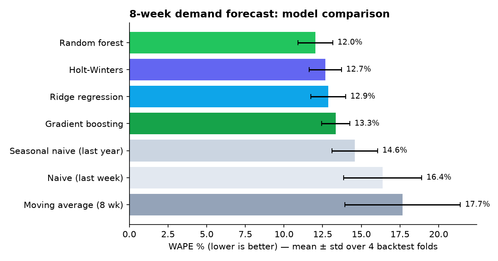
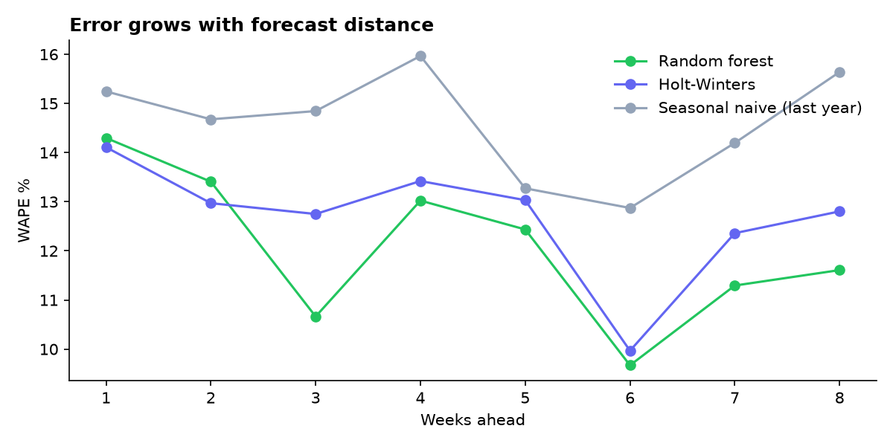
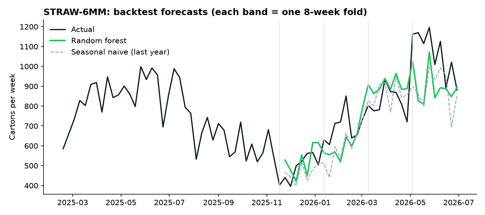
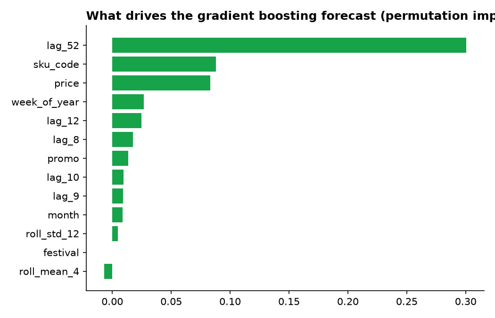

# Demand Forecasting: 7 Models, One Fair Backtest

Forecasting weekly demand (cartons) **8 weeks ahead** for 10 products of a B2B
company, and comparing simple baselines, a statistical model and machine-learning
models on exactly the same rolling backtest.

> **Data note:** the dataset is **synthetic** — generated by `src/data.py` to behave like real
> B2B demand (trend, summer seasonality, festival spikes, promotions, yearly price increases,
> noise). No company data is used. The method is the same one used on real sales data.



## Results

Rolling-origin backtest: 4 folds × 8 weeks, all 10 SKUs (320 forecasts per model).

| Model | WAPE % | MAE | RMSE | Bias % | WAPE std across folds |
|---|---|---|---|---|---|
| **Random forest** | **12.03** | 47.9 | 69.4 | −1.3 | 1.13 |
| Holt-Winters | 12.67 | 50.5 | 73.3 | −4.4 | 1.05 |
| Ridge regression | 12.87 | 51.3 | 73.5 | −1.3 | 1.12 |
| Gradient boosting | 13.35 | 53.2 | 80.6 | −1.9 | 0.91 |
| Seasonal naive (same week last year) | 14.58 | 58.1 | 83.0 | −5.9 | 1.48 |
| Naive (last week) | 16.39 | 65.3 | 89.3 | −8.3 | 2.52 |
| Moving average (8 weeks) | 17.68 | 70.5 | 103.1 | −9.4 | 3.73 |

**Key findings**

- **Random forest is best: 12.0% WAPE, 17.5% lower error than the seasonal-naive baseline** —
  about **100 fewer cartons of forecast error per week** across the 10 products.
- **Holt-Winters is a close second (12.7%).** The ML gain over a well-tuned statistical model is
  real but modest, and smaller than the fold-to-fold variation (~1 point). In production I would
  weigh that against the extra complexity — an honest result, not a "deep learning wins" story.
- The ML models are much **less biased** (−1.3%) than the baselines (−6% to −9%), which matters
  for stock planning: biased forecasts lead to systematic stock-outs.
- **Same week last year (`lag_52`) is by far the strongest signal**, followed by product, price
  and week of year. `festival` shows no importance only because the last fold (May–June) has no
  festival weeks. `price` partly acts as a time signal (prices rise once a year).

| Error by forecast distance | Forecast vs actual (one SKU) |
|---|---|
|  |  |



## Approach

1. **Data** (`src/data.py`): 157 weeks × 10 SKUs, fixed random seed.
2. **Features** (`src/features.py`): lags 8–12 and 52 weeks, rolling mean/std, week of year,
   month, price, promo and festival flags, product code.
   - **Direct multi-step strategy:** every demand-based feature is lagged by at least the
     8-week horizon, so the same model can forecast weeks 1–8 without using anything that would
     be unknown on the forecast date. Price, promotions and festivals are planned in advance,
     so they are allowed as future-known inputs.
3. **One global ML model for all products:** the target and lag features are divided by each
   product's recent 12-week level, so a single model learns shared patterns across products that
   sell 150 or 500 cartons a week, then predictions are scaled back.
4. **Models** (`src/models.py`): naive, seasonal naive, moving average, Holt-Winters (damped
   trend + yearly seasonality, one per SKU), ridge regression, random forest, gradient boosting.
5. **Evaluation** (`src/run.py`): rolling-origin backtest — train on everything up to a cutoff,
   forecast the next 8 weeks, move the cutoff forward, repeat 4 times. Metrics: WAPE (main),
   MAE, RMSE and bias.
6. **Leakage tests** (`tests/test_no_leakage.py`): changing the demand inside the forecast window
   must not change any feature — the tests prove it doesn't.

## Run it

```bash
pip install -r requirements.txt
python src/run.py              # backtest + charts → results/
python tests/test_no_leakage.py
```

## What I would do next on real data

- Prediction intervals (quantile models) to set safety stock directly.
- Hierarchical reconciliation so SKU forecasts add up to category and total forecasts.
- Add customer-level order signals (open orders, pipeline deals) as leading indicators.
